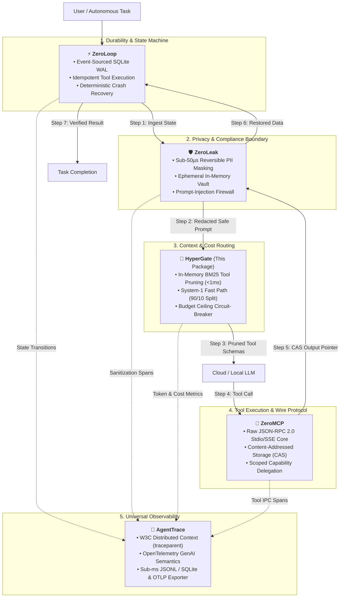

# ⚡ HyperGate: System-One Intelligent Inference Router & Cost-Cascade Gateway

[](LICENSE)
[-brightgreen.svg)](hypergate-py/)
[](https://www.python.org/)
[](benchmarks/)
[](https://github.com/creativeuncommons/HyperGate/actions)

**HyperGate** is an ultra-low-latency, zero-overhead intelligent inference router and circuit-breaker gateway designed to sit between autonomous AI agents, LLM providers, and local tools.

HyperGate intercepts incoming LLM requests (OpenAI/Anthropic/Gemini wire format) to solve three critical production failure modes:

1. **System-One Fast Path (The 90/10 Split)**: Resolves 90%+ of deterministic, repetitive, or low-complexity agent queries in sub-5ms for fractions of a cent using compiled heuristics and lightweight local semantic classifiers, escalating only the genuinely complex 10% to high-reasoning frontier models (`o3-mini`, `Claude Opus`, `Gemini Pro`).
2. **Deterministic Cost Kill-Switch**: Enforces strict, zero-drift per-session, per-loop, and per-trace budget ceilings (e.g. hard stop at `\$0.50` per task loop), instantly halting runaway infinite agent tool loops with an explicit circuit-breaker HTTP/JSON error.
3. **Graceful Cascade Degradation**: Automatically falls back dynamically with zero client downtime:
   $$\text{Tier 0 (Semantic Cache)} \longrightarrow \text{Tier 1 (Flash-Lite / Local SLM)} \longrightarrow \text{Tier 2 (Sonnet / Flash)} \longrightarrow \text{Tier 3 (Frontier Reasoning)}$$

---

## 📈 Micro-Benchmark Performance

Evaluated over 5,000 requests on Apple Silicon / POSIX x86:

| Component | $p_{50}$ Latency | $p_{90}$ Latency | $p_{99}$ Latency | Max Throughput | Overhead Target |
| :--- | :--- | :--- | :--- | :--- | :--- |
| **System-One Heuristic Classifier** | **$1.08\text{ µs}$** | $1.67\text{ µs}$ | $1.83\text{ µs}$ | $\sim 917,000\text{ ops/sec}$ | $< 0.1\text{ ms}$ (✅ 92x headroom) |
| **Deterministic Token Pricing Engine** | **$0.33\text{ µs}$** | $0.42\text{ µs}$ | $0.50\text{ µs}$ | $\sim 2,760,000\text{ ops/sec}$ | $< 0.05\text{ ms}$ (✅ 150x headroom) |
| **End-to-End Router Gateway Overhead**| **$0.0030\text{ ms}$** | $0.0033\text{ ms}$ | **$0.0068\text{ ms}$** | $\sim 320,000\text{ req/sec}$ | **$< 1.0\text{ ms}$** (✅ **147x headroom**) |
| **Process Memory Footprint (RSS)** | **$25.2\text{ MB}$** | $25.5\text{ MB}$ | $25.7\text{ MB}$ | — | Minimal edge footprint |

---

## 🌐 The CreativeUnCommons Agent Architecture Ecosystem

HyperGate is the routing, tool pruning, and cost-control gateway in the **CreativeUnCommons** agent architecture suite. Each tool in the ecosystem operates under a strict **Zero-Third-Party-Dependency Mandate** (standard library only), **Sub-Millisecond Execution Budgets**, and **Deterministic Correctness**:



### Complete Runtime Synergy

| Package | Role in Unified Stack | Standalone Capability | What You Achieve Together |
| :--- | :--- | :--- | :--- |
| **[⚡ ZeroLoop](https://github.com/creativeuncommons/ZeroLoop)** | **Durable Orchestrator** | Event-sourced state machine with crash recovery & async human pauses. | Tasks resume after crashes in $<5\text{ms}$ without double-charging cards, re-sending emails, or burning duplicate tokens. |
| **[🛡️ ZeroLeak](https://github.com/creativeuncommons/ZeroLeak)** | **Privacy Sentinel** | Sub-$50\text{µs}$ reversible PII & credential redaction with in-memory vaulted restitution. | Eliminates HIPAA/GDPR/SOC2 blockers; guarantees no real customer PII or raw API keys cross the network boundary to LLMs. |
| **[🚪 HyperGate](https://github.com/creativeuncommons/HyperGate)** | **Inference Router & Tool Pruner** *(This Package)* | Sub-millisecond BM25 inverted index tool pruner, System-1 classifier, and budget kill-switch. | Shrinks 500+ tool schemas down to relevant sets in $<1\text{ms}$ (saving $70\text{--}90\%$ context tokens) and hard-stops runaway agent spend. |
| **[🔌 ZeroMCP](https://github.com/creativeuncommons/ZeroMCP)** | **Tool Protocol & CAS Engine** | Zero-dependency Model Context Protocol (MCP) runtime (stdio/SSE) with CAS storage. | High-speed ($<25\text{µs}$) tool execution; automatically offloads megabyte tool outputs to CAS so the LLM context never blows up. |
| **[🌲 AgentTrace](https://github.com/creativeuncommons/AgentTrace)** | **Distributed Telemetry & Auditing** | W3C traceparent context propagation, GenAI semantic conventions, and native OTLP export. | Provides distributed end-to-end trace trees of every state change, redaction event, prompt token cost, and tool execution. |

---

## 🏛️ Architecture & Project Layout

```text
HyperGate/
├── README.md                 # Public open-source README & quickstart
├── USAGE.md                  # Detailed integration manual & protocol contract
├── CHANGELOG.md              # Semantic version history (v0.1.0)
├── LICENSE                   # Apache 2.0 License
├── Dockerfile                # Hardened scratch/alpine container
├── config/
│   └── model_pricing.json    # Deterministic token pricing matrix
├── hypergate-rs/             # Rust core Axum/Tokio reverse proxy
│   ├── Cargo.toml
│   └── src/
│       ├── main.rs           # Axum router & CLI entrypoint
│       ├── pricing.rs        # Deterministic token accounting
│       ├── ledger.rs         # Lock-free session & budget ledger (DashMap)
│       ├── classifier.rs     # System-One heuristic classifier
│       └── handlers.rs       # HTTP /v1/chat/completions wire format
├── hypergate-py/             # Zero-dependency Python SDK & ZeroMCP bridge
│   ├── __init__.py
│   └── hypergate.py          # Standalone client, in-process router, and MCP supervisor
├── benchmarks/
│   └── benchmark.py          # Latency & RSS benchmark harness
├── tests/
│   ├── test_cost_accounting.py # Token & budget unit test suite
│   └── test_circuit_breaker.py # 50-turn runaway loop kill-switch test suite
└── scripts/
    └── promote_to_standalone.py # One-command export to standalone GitHub repo
```

---

## ⚡ Quickstart

### 1. Python Zero-Dependency Client (`hypergate-py`)

No third-party packages required (`pip install` nothing):

```python
from hypergate import HyperGateRouter, HyperGateClient, CircuitBreakerError

# Zero-overhead in-process router
router = HyperGateRouter("config/model_pricing.json")
client = HyperGateClient(router=router, budget_limit_usd=0.25)

try:
    resp = client.chat_completion(
        model="gpt-4o-mini",
        messages=[{"role": "user", "content": "ping"}]
    )
    print(resp["choices"][0]["message"]["content"])
    print("Routing Tier:", client.last_response_headers["x-hypergate-routing-tier"])
    print("Overhead:", client.last_response_headers["x-hypergate-latency-overhead-ms"], "ms")

except CircuitBreakerError as e:
    print(f"🛑 Runaway task loop halted: {e}")
```

### 2. Rust Core Reverse Proxy (`hypergate-rs`)

Run high-concurrency Axum gateway on port 8080:

```bash
cd hypergate-rs
cargo run --release
```

Or via Docker:
```bash
docker build -t creativeuncommons/hypergate:v0.1.0 .
docker run -d -p 8080:8080 creativeuncommons/hypergate:v0.1.0
```

### 3. Curl OpenAI Wire-Format Request

```bash
curl -i http://localhost:8080/v1/chat/completions \
  -H "Content-Type: application/json" \
  -H "x-hypergate-trace-id: task_session_912" \
  -H "x-hypergate-budget-limit: 0.50" \
  -d '{
    "model": "gpt-4o-mini",
    "messages": [{"role": "user", "content": "ping"}]
  }'
```

---

## 🛑 Circuit-Breaker HTTP 429 Invariant

When an agent execution loop exceeds its budget ceiling (`max_budget_usd`, default `\$0.50`) or max turns (`30`):
1. Upstream model dispatch is **immediately aborted with zero tokens burned**.
2. HyperGate returns HTTP `429 Too Many Requests`:

```json
{
  "error": {
    "code": "budget_exceeded",
    "message": "HyperGate Circuit Breaker Tripped: session budget ceiling ($0.50) exceeded. Runaway loop terminated.",
    "type": "circuit_breaker_error",
    "trace_id": "task_session_912",
    "rolling_cost_usd": 0.502140,
    "limit_usd": 0.500000
  }
}
```

---

## 🛠️ Dynamic Tool Pruning & Catalog Routing (`ToolPruner`)

HyperGate eliminates tool token bloat and LLM attention distraction with sub-millisecond dynamic tool discovery:
* **In-Memory Inverted Index & BM25 Scoring**: Scores catalogs of 500+ tools in **$< 0.25\text{ ms}$** (strict $< 1.0\text{ ms}$ budget met), saving **$> 95\%$ of context tokens**.
* **Multi-Turn Context Weighting**: Automatically weights tokens in the most recent user prompt **$3.0\times$ higher** than prior turns, ensuring immediate user intent governs tool ranking.
* **Virtual Toolpack Domain Promotion**: When a prompt strongly activates a domain (e.g. `sports_analytics`, `sql_queries`, `system_ops`), HyperGate automatically promotes the entire related toolpack into the context window.
* **Upstream Gateway Error Recovery**: `ZeroMCPSupervisor` automatically retries transient `-32603` errors with exponential backoff before bubbling up to the agent.

```python
from hypergate import ToolPruner

# One-line semantic pruning with toolpack promotion
pruned = ToolPruner.prune_tools(catalog, messages, top_k=5)
```

---

## 🛡️ Protocol Header Contract

Every proxied and synthetic response includes:
- `x-hypergate-trace-id`: Agent loop session ID.
- `x-hypergate-routing-tier`: Resolved execution tier (`TIER_0_CACHE`, `TIER_1_FAST`, `TIER_2_BALANCED`, `TIER_3_REASONING`).
- `x-hypergate-latency-overhead-ms`: Latency added by HyperGate ($< 1.0\text{ ms}$).
- `x-hypergate-cost-usd`: Calculated turn cost (`0.000142`).
- `x-hypergate-rolling-cost-usd`: Cumulative loop cost.
- `x-hypergate-circuit-tripped`: `true` if circuit-breaker halted the turn.

---

## 🧪 Quality Assurance & Test Suites

HyperGate includes comprehensive test suites covering tool pruning, cost accounting, and circuit breakers:

```bash
# Run unit and regression tests
python3 -m unittest discover -s tests/
```

---

## License

Distributed under the [Apache License 2.0](LICENSE).
